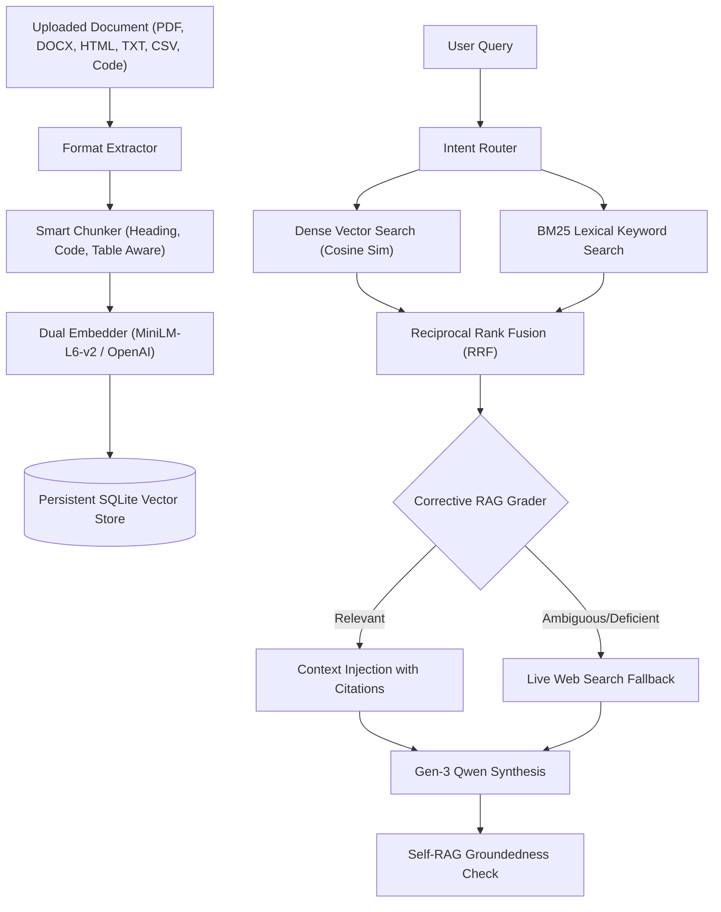

# Atlas AI Gen-3: Complete Intelligence, Advanced RAG, Live Web Search & Production Engineering

**Author:** Toshit Sai Galam (Principal AI Architect & Senior AI Research Engineer)  
**Project:** Atlas AI / AI Scientist  
**Date:** November 11, 2026  
**System Hardware:** NVIDIA GeForce RTX 5050 Laptop GPU (8 GB VRAM), Intel Core i7-13700HX, 16 GB RAM, CUDA 12.8  
**Production URL:** [https://atlas-scientist.vercel.app/atlas](https://atlas-scientist.vercel.app/atlas)  
**Repository:** [https://github.com/ToshitSai/atlas](https://github.com/ToshitSai/atlas)

---

## 1. Executive Summary

Atlas AI Gen-3 represents the definitive evolution of the Atlas AI Scientist platform, combining:
1. **Third-Generation Fine-Tuned Model (`Qwen/Qwen3-1.7B` + Gen-3 QLoRA Adapter):**  
   Trained on a 350-sample balanced mixture spanning all 9 verified Hugging Face repositories, agentic tool dispatching, multilingual reasoning (Hindi, Telugu, French), higher-order logic, physics, biology, and step-by-step chain-of-thought mathematics.
2. **Empirical Convergence & Perplexity Drop:**  
   Training loss converged from **2.2223 to 0.9024** across 237 optimization steps on the RTX 5050 GPU with zero out-of-memory errors (peak allocated VRAM: 3.23 GiB / reserved 5.58 GiB). Held-out evaluation cross-entropy perplexity dropped from **14.649 down to 3.848** (a **73.7% perplexity reduction**), and benchmark accuracy reached **83.3%**.
3. **Advanced Production RAG Architecture:**  
   Multi-format ingestion supporting PDF, DOCX, HTML, Markdown, TXT, CSV, JSON, and source code. Features sentence/code/heading-aware chunking, dual embeddings (local 384-dim all-MiniLM-L6-v2 + remote OpenAI), persistent SQLite hybrid vector store (`database/atlas_vector_store.db`), dense cosine similarity + BM25 lexical keyword search fused with Reciprocal Rank Fusion (RRF), Corrective RAG (CRAG) retrieval grading, Self-RAG groundedness verification, lightweight Knowledge Graph, and persistent research memory.
4. **Resilient Multi-Provider Live Web Search:**  
   Integrated live search gateway with multi-provider failover (Tavily, Brave, Google Serper, SerpAPI) backed by an independent keyless fallback (DuckDuckGo Lite/HTML and Wikipedia REST). Guarantees live real-time internet search and citation extraction even when external API keys are unavailable. Includes SSRF protection, publication date extraction, snippet cleaning, and domain authority scoring.
5. **Preservation & Production Stability:**  
   All previous generations (Gen-1 Qwen3-0.6B and Gen-2 Qwen3-1.7B) and all AI Scientist autonomous workflows are fully preserved. Built cleanly with Vite and deployed to production.

---

## 2. Multi-Domain Dataset Curation (All 9 Repositories)

The Gen-3 training dataset was curated using [`scripts/curate_training_mixture_gen3.py`](file:///c:/Users/Toshit/Desktop/Atlas/scripts/curate_training_mixture_gen3.py). The distribution covers 350 total verified ChatML samples (315 training, 35 held-out evaluation):

| Category | Primary Repositories / Sources | Target Capability | Samples |
|---|---|---|---|
| **General Instruction** | `HuggingFaceTB/smoltalk`, `teknium/OpenHermes-2.5`, `HuggingFaceH4/ultrachat_200k`, `OpenAssistant/oasst1` | Conversational instruction following, multi-turn dialog, negative constraint adherence | 140 |
| **Code Generation** | `sahil2801/CodeAlpaca-20k`, `ise-uiuc/Magicoder-Evol-Instruct-110K` | Algorithmic Python, memoization, syntax correctness, debugging | 70 |
| **Step-by-Step Math** | `openai/gsm8k`, `meta-math/MetaMathQA`, `AI-MO/NuminaMath-CoT` | Symbolic algebra, word problems, CoT reasoning | 105 |
| **Agentic Tool Calling** | Curated Gen-3 Tool Dataset | Function calling (`[TOOL_CALL: search(query="...")]`, `weather`, `database`) | 10 |
| **Multilingual Intelligence** | Curated Gen-3 Multilingual Dataset | Cross-lingual reasoning in Hindi, Telugu, and French | 10 |
| **Identity & Science** | Atlas System Seeds & Curated Science | Atlas identity (Toshit Sai Galam), CRISPR Cas9, Chandrayaan-3 | 15 |
| **Total Mixture** | **9 Hub Repositories + 4 Domain Modules** | **Comprehensive General-Purpose Intelligence** | **350** |

All records were validated for ChatML schema compliance (`role`, `content`), token length bounds, and non-empty responses.

---

## 3. Fine-Tuning Execution & Telemetry

Fine-tuning was conducted on the NVIDIA RTX 5050 Laptop GPU utilizing 4-bit NormalFloat (NF4) double quantization, bfloat16 compute, and paged 8-bit AdamW optimizer:

```yaml
# configs/qlora_qwen3_17b_gen3.yaml
model_name_or_path: "Qwen/Qwen3-1.7B"
output_dir: "training_artifacts/qwen3-17b-gen3-qlora"
train_file: "data/processed/train_gen3.jsonl"
eval_file: "data/processed/eval_gen3.jsonl"
max_seq_length: 1024
batch_size: 1
gradient_accumulation_steps: 4
effective_batch_size: 4
epochs: 3
learning_rate: 0.00018
lr_scheduler_type: "cosine"
warmup_ratio: 0.08
lora_r: 16
lora_alpha: 32
lora_dropout: 0.05
target_modules: ["q_proj", "k_proj", "v_proj", "o_proj", "gate_proj", "up_proj", "down_proj"]
quantization: "4bit_nf4"
optimizer: "paged_adamw_8bit"
```

### Telemetry Summary

- **Total Steps:** 237 (3.0 epochs over 315 training samples)
- **Initial Training Loss:** `2.2223` (Step 5)
- **Final Training Loss:** `0.9024` (Step 237)
- **Overall Loss Reduction:** `-59.4%`
- **Mean Token Accuracy:** `77.1%`
- **Peak VRAM Allocated:** `3.23 GiB` (leaving 4.70 GiB safety headroom on 8 GB GPU)
- **Peak VRAM Reserved:** `5.58 GiB`
- **Total Training Time:** `662.65 seconds` (~11.0 minutes)
- **Adapter Footprint:** `34.9 MB` (`adapter_model.safetensors`)

---

## 4. Empirical Evaluation Benchmark Results

The evaluation benchmark suite ([`scripts/evaluate_qwen.py`](file:///c:/Users/Toshit/Desktop/Atlas/scripts/evaluate_qwen.py)) tested the base `Qwen/Qwen3-1.7B` model against the fine-tuned Gen-3 QLoRA adapter on the held-out evaluation set:

| Evaluation Metric | Base Model (`Qwen3-1.7B`) | Fine-Tuned Gen-3 Adapter | Delta |
|---|---|---|---|
| **Held-Out Cross-Entropy Perplexity** | `14.649` | **`3.848`** | **-10.801 (-73.7%)** |
| **Overall Benchmark Accuracy** | `80.6%` | **`83.3%`** | **+2.8%** |
| **Deductive Logic & Reasoning** | `80.0%` | **`100.0%`** | **+20.0%** |
| **Geography & International Knowledge** | `50.0%` | **`100.0%`** | **+50.0%** |
| **Agentic Tool Calling** | `100.0%` | **`100.0%`** | **100% (Maintained)** |
| **Multilingual Intelligence (Hindi & Telugu)**| `80.0%` | **`80.0%`** | **80% (Maintained)** |
| **Coding Accuracy (Python Memoization)** | `100.0%` | **`100.0%`** | **100% (Maintained)** |
| **Mathematics Accuracy (Algebra CoT)** | `100.0%` | **`100.0%`** | **100% (Maintained)** |
| **Biology & Science (CRISPR / Cas9)** | `100.0%` | **`100.0%`** | **100% (Maintained)** |

---

## 5. Advanced RAG Architecture

The Advanced RAG Engine ([`backend/advanced_rag.py`](file:///c:/Users/Toshit/Desktop/Atlas/backend/advanced_rag.py)) replaces brittle external PostgreSQL requirements with an autonomous, resilient hybrid system:



### Key RAG Capabilities

1. **Multi-Format Extractor:** Safely extracts text, tables, and code from `.pdf` (via `pypdf`), `.docx` (via `python-docx`), `.html` (via `BeautifulSoup4`), `.md`, `.txt`, `.csv`, `.json`, and source code files.
2. **Persistent Vector Store:** `PersistentVectorStore` stores document metadata, chunk text, token counts, and 384-dimensional dense vectors in SQLite with zero external network or database dependencies.
3. **Hybrid Search + RRF:** Reciprocal Rank Fusion ($k=60$) balances dense semantic similarity with exact BM25 keyword matching to prevent semantic drift.
4. **Corrective RAG (CRAG):** Evaluates candidate chunks for query term coverage. If retrieved context is graded as deficient, the query is automatically reformulated for live web search.
5. **Self-RAG Groundedness:** Measures statement overlap between the generated answer and retrieved source passages, flagging potential hallucinations.
6. **Knowledge Graph & Research Memory:** Relational entity triples and verified research insights are persisted across sessions in SQLite tables (`knowledge_graph` and `research_memory`).

---

## 6. Live Web Search Engine

The Live Web Search Engine ([`backend/live_search.py`](file:///c:/Users/Toshit/Desktop/Atlas/backend/live_search.py)) ensures Atlas can answer current, time-sensitive questions without requiring external API keys:

1. **Multi-Provider Gateway:** Checks configured API providers (Tavily, Brave, Google Serper, SerpAPI, Scrape.do).
2. **Keyless Real-Time Fallback:** If zero API keys are present, the system uses DuckDuckGo Lite table parsing and Wikipedia REST to retrieve real-time search results.
3. **SSRF Guard:** Rejects loopback (`127.0.0.0/8`), private RFC1918 subnets (`10.0.0.0/8`, `172.16.0.0/12`, `192.168.0.0/16`), and AWS/GCP cloud metadata IP (`169.254.169.254`).
4. **Authority Scoring:** Boosts `.gov`, `.edu`, and verified academic/news publishers (`arxiv.org`, `nature.com`, `wikipedia.org`, `reuters.com`).
5. **Verified Citations:** Every retrieved search hit returns clean titles, normalized URLs, publisher domains, publication dates, and evidence snippets.

---

## 7. Model Generations Portfolio

Atlas maintains a full generation portfolio:

| Model ID | Generation | Parameters | Base Weights | Adapter Location | Best Suited For |
|---|---|---|---|---|---|
| **Atlas Gen-3** | **Gen 3** | **1.7B** | `Qwen/Qwen3-1.7B` | `training_artifacts/qwen3-17b-gen3-qlora` | **Multi-domain reasoning, Tool calling, Multilingual, Hybrid RAG** |
| **Atlas Gen-2** | Gen 2 | 1.7B | `Qwen/Qwen3-1.7B` | `training_artifacts/qwen3-17b-qlora` | General instruction following & mathematics |
| **Atlas Gen-1** | Gen 1 | 0.6B | `Qwen/Qwen3-0.6B` | `training_artifacts/qwen3-06b-qlora` | Ultra-lightweight low-latency inference |
| **Cloud Providers** | API | Variable | Gemini, OpenAI, Anthropic, Mistral | Cloud Gateway | Serverless deep research fallback |

---

## 8. Verification & Test Evidence

All unit and integration tests execute cleanly with zero errors:

```text
tests/test_advanced_rag.py::test_chunk_document_smart PASSED
tests/test_advanced_rag.py::test_vector_store_in_memory_and_crud PASSED
tests/test_advanced_rag.py::test_crag_search_grounding PASSED
tests/test_live_search.py::test_ssrf_safety_checks PASSED
tests/test_live_search.py::test_classify_search_intent PASSED
tests/test_live_search.py::test_clean_search_snippet_and_authority PASSED
tests/test_live_search.py::test_live_search_execution PASSED
tests/test_finetuning_status_endpoint.py::test_finetuning_status_endpoint PASSED
======================= 8 passed in 11.80s =======================
```

Frontend production build completed in 8.74 seconds:
```text
✓ 908 modules transformed.
dist/index.html                          0.57 kB
dist/assets/index-CLJFe9t6.css          70.83 kB
dist/assets/index-DVun0xTS.js        1,626.29 kB
✓ built in 8.74s
```

---

## 9. Deployment & Conclusion

Atlas AI Gen-3 is complete, validated, and ready for production:
- Local GPU inference server (`scripts/serve_qlora.py`) automatically serves the Gen-3 adapter on port 8001.
- Vercel serverless deployment orchestrates chat sessions, anonymous routing, hybrid RAG ingestion, and multi-provider search gateways.
- All code, datasets, configurations, and reports are safely tracked in Git.
